# Chatbot de WhatsApp de VenteRental — Especificación funcional y técnica

**Versión:** 1.0 · **Fecha:** 2026-11-17 · **Estado:** implementado; con 17 preguntas de negocio pendientes (sección 13)

> **Alcance de la fuente.** Esta especificación se construyó a partir del **texto** del documento "Proyecto: diseño y desarrollo del chatbot de VenteRental". Las **imágenes de los diagramas originales no se recibieron**. Por eso, toda conexión que el texto no define explícitamente aparece como **pendiente** (código `P-xx`) y se implementó con una ruta conservadora que **nunca envía el caso a un especialista sin que el texto lo indique**. Al recibir los diagramas, cada `P-xx` se resuelve cambiando una línea en `src/lib/chatbot/flujo.mjs`.

**Convención de origen** (se usa en todo el documento):

| Marca | Significado |
|---|---|
| 🟢 **Original** | Texto o regla tomados literalmente del documento comercial. |
| 🟡 **Pendiente (P-xx)** | Conexión no visible o no definida; se usa una ruta provisional que debe confirmarse. |
| 🔵 **Propuesto** | Mejora o texto nuevo (no existía en el original); requiere aprobación comercial. |

---

## 1. Resumen ejecutivo

El chatbot atiende por WhatsApp a todos los leads de VenteRental. Hace cuatro cosas:

1. Obtiene la **autorización de tratamiento de datos**, sin la cual no captura información comercial.
2. Identifica el **servicio** de interés entre las cinco líneas de negocio.
3. Hace las **preguntas de precalificación** propias de cada servicio, en rutas independientes.
4. Según el resultado, **solicita una cita con un especialista**, informa que **no se cumple un requisito** o deja el caso **pendiente de revisión**.

Cada lead, conversación, respuesta, mensaje y solicitud queda registrado. El cliente puede pedir un **asesor humano** en cualquier momento, corregir su última respuesta, volver al menú y retomar una conversación interrumpida.

**Estado actual:**
- El motor, el flujo de los 5 servicios, la integración con WhatsApp y las 52 pruebas automatizadas están implementados en el repositorio y pasan.
- Para producción falta conectar Upstash Redis (gratis, sección 14), configurar las credenciales de Meta (`docs/whatsapp-bot.md`) y responder las preguntas de la sección 13.

| Componente | Archivo |
|---|---|
| Flujo (nodos, textos, reglas) | `src/lib/chatbot/flujo.mjs` |
| Motor de conversación | `src/lib/chatbot/motor.mjs` |
| Canal WhatsApp | `src/lib/chatbot/whatsapp.mjs`, `src/pages/api/whatsapp.js` |
| Persistencia | `src/lib/chatbot/store/`: Upstash Redis (producción, gratis) · memoria (pruebas) · Postgres (opcional, `docs/chatbot/schema.sql`) |
| Asignación y notificaciones | `src/lib/chatbot/asignacion.mjs`, `notificaciones.mjs` |
| Pruebas | `tests/chatbot.test.mjs`, `tests/chatbot-redis.test.mjs` (`npm run test:chatbot`) |

---

## 2. Análisis del flujo original

**Estructura.** Hay una entrada común (bienvenida y consentimiento → nombre → selección de servicio) seguida de cinco flujos independientes que terminan en uno de tres desenlaces: solicitud de contacto con especialista, salida por incumplimiento de requisitos, o salida sin consentimiento.

**Hallazgos e inconsistencias** (cada uno remite a una pregunta de la sección 13):

| # | Hallazgo | Tratamiento |
|---|---|---|
| H1 | La URL de la política de datos es un marcador (`www.politicatratamientodatos`). | Configurable (`POLITICA_DATOS_URL`); hoy apunta a `/terminos`. **P-01** |
| H2 | El nombre comercial aparece como "VenteRental"; el sitio web usa "VentRentAll". | Se conserva "VenteRental" en una constante (`MARCA`). **P-02** |
| H3 | Compra de vehículo: el diagrama tiene ramificaciones adicionales por tipo de persona que no se describen. | Se crean nodos separados por tipo de persona (102N/102J) para poder ramificarlos; hoy ambos van al especialista. **P-03** |
| H4 | Crédito vehicular: el texto numera primero Data Crédito (201) y luego tipo de persona (203), pero exige conservar la pregunta de Data Crédito según el tipo de persona. | Se pregunta primero el tipo de persona para poder usar la pregunta correcta ("usted" o "su empresa"). **P-04** |
| H5 | Respuesta "SÍ" a Data Crédito: el texto prohíbe asumir rechazo o aprobación. | Salida *pendiente de revisión* (sin especialista y sin rechazo). **P-05** |
| H6 | Crédito vehicular, persona jurídica no reportada: destino no definido. | Va al especialista (provisional). **P-06** |
| H7 | Situación laboral: no se definen condiciones por tipo de trabajo. | Las 4 opciones van al especialista (provisional). **P-07** |
| H8 | Activos – Tecnología: el texto la envía directo al especialista, sin validar antigüedad ni ventas. | Se respeta el texto; queda para confirmar. **P-08** |
| H9 | Las salidas por antigüedad y por ventas no tienen texto original. | Textos propuestos. **P-09** |
| H10 | El renting dice "más de un año"; el sitio web dice "contratos mayores a 2 años". | Se conserva "más de un año". **P-10** |
| H11 | Renting de vehículos, persona jurídica: preguntas no visibles. | Va al especialista (provisional). **P-11** |
| H12 | El trato "Sr./Señor" asume el género del cliente. | Se conserva el original. Propuesta: "Sr(a).". **P-12** |
| H13 | "5 mil millones anual": no se indica la moneda. | Se conserva el texto exacto. **P-13** |

---

## 3. Inventario de nodos

| ID | Servicio | Tipo | Origen | Descripción |
|---|---|---|---|---|
| 001 | Común | sistema | 🟢 | Ingreso del lead: identifica o crea el lead y la conversación. |
| 002 | Común | pregunta SI/NO | 🟢 | Bienvenida y aceptación de la política de datos. |
| 003 | Común | texto | 🟢 | Captura del nombre. |
| 004 | Común | pregunta (5) | 🟢 | Selección de servicio. |
| 101 | 1 Compra | pregunta (2) | 🟢 | Tipo de persona. |
| 102N | 1 Compra | pregunta (2) | 🟢 | Modalidad de compra (persona natural). |
| 102J | 1 Compra | pregunta (2) | 🟢 | Modalidad de compra (persona jurídica). |
| 103 | 1 Compra | contacto | 🟢 | Día y hora para el especialista. |
| 203 | 2 Crédito | pregunta (2) | 🟢 | Tipo de persona. |
| 201 | 2 Crédito | pregunta SI/NO | 🟢 | ¿Está usted reportado en Data Crédito? |
| 201J | 2 Crédito | pregunta SI/NO | 🟢 | ¿Está su empresa reportado en Data Crédito? |
| 202 | 2 Crédito | pregunta (4) | 🟢 | Situación laboral. |
| 204 | 2 Crédito | contacto | 🟢 | Día y hora para el especialista. |
| 301 | 3 Activos | mensaje | 🟢 | Explicación (solo empresas). |
| 302 | 3 Activos | pregunta (6) | 🟢 | Tipo de activo. |
| 303 | 3 Activos | pregunta (4) | 🟢 | Subclasificación de tecnología. |
| 304 | 3 Activos | pregunta SI/NO | 🟢 | Antigüedad ≥ 3 años. |
| 305 | 3 Activos | pregunta SI/NO | 🟢 | Ventas ≥ 5 mil millones anual. |
| 306 | 3 Activos | contacto | 🟢 | Día y hora para el especialista. |
| 401 | 4 Renting | mensaje | 🟢 | "Únicamente rentamos a largo plazo más de un año". |
| 401B | 4 Renting | mensaje | 🟢 | Explicación del renting. |
| 402 | 4 Renting | pregunta (2) | 🟢 | Tipo de persona. |
| 403 | 4 Renting | pregunta SI/NO | 🟢 | ¿Está usted reportado en Data Crédito? |
| 404 | 4 Renting | pregunta SI/NO | 🟢 | Ingresos ≥ 4.500.000. |
| 405 | 4 Renting | contacto | 🟢 | Día y hora para el especialista. |
| 501 | 5 Crédito empresa | mensaje | 🟢 | Presentación (solo empresas). |
| 502 | 5 Crédito empresa | pregunta SI/NO | 🟢 | Antigüedad ≥ 5 años. |
| 503 | 5 Crédito empresa | pregunta SI/NO | 🟢 | Ventas ≥ 5 mil millones anual. |
| 504 | 5 Crédito empresa | contacto | 🟢 | Día y hora para el especialista. |
| S-002 | Salida | fin | 🔵 | Sin consentimiento de datos. |
| S-ING | Salida | fin | 🟢 | Rechazo por ingresos (texto original). |
| S-ANT3 / S-ANT5 | Salida | fin | 🔵 | No cumple antigüedad (3 o 5 años). |
| S-VEN | Salida | fin | 🔵 | No cumple ventas. |
| S-REV | Salida | fin | 🔵 | Pendiente de revisión comercial. |
| S-CITA | Salida | fin | 🔵 | Confirmación de la solicitud de contacto. |
| R-001 | Sistema | pregunta (2) | 🔵 | Reanudación tras inactividad. |
| H-001 | Sistema | transferencia | 🔵 | Paso a asesor humano. |

---

## 4. Conversación completa del chatbot

Textos exactos que envía el bot. `[NOMBRE]` se reemplaza por el nombre capturado en el nodo 003.

### Entrada

**002** 🟢 (botones **SI** / **NO**)
> Hola, bienvenido a VenteRental. Somos distribuidores de diferentes marcas y vendemos y rentamos activos productivos (más de un año). Al utilizar este medio acepta términos y condiciones de WhatsApp; para continuar con nuestra asesoría debes aceptar la política de tratamiento de datos personales que puede ser consultada en `{POLITICA_DATOS_URL}`, si la aceptas digita SI, o en caso contrario digita NO.

**003** 🟢
> Hola, entiendo que estás interesado(a) en conocer nuestra figura y servicios. Dime ¿Cuál es tu nombre?

**004** 🟢 (lista de 5 opciones)
> Sr. [NOMBRE], seleccione el número del servicio en el que está interesado(a):
> 1. Compra de vehículo nuevo. 2. Gestionar crédito vehicular. 3. Renta de activos productivos. 4. Renta de vehículos a largo plazo. 5. Crédito para tu empresa.

### Flujo 1 — Compra de vehículo nuevo
- **101** 🟢 Señor [NOMBRE], ¿qué tipo de persona es usted? 1. PERSONA NATURAL. 2. PERSONA JURÍDICA.
- **102N / 102J** 🟢 El vehículo que quiere comprar lo va a realizar: 1. Con crédito vehicular. 2. De contado.
- **103** 🟢 A continuación un especialista se comunicará con usted para poder procesar su solicitud. ¿En qué día y hora desea que el especialista se comunique con usted?

### Flujo 2 — Gestión de crédito vehicular
- **203** 🟢 (tipo de persona, mismo texto de 101)
- **201** 🟢 Sr. [NOMBRE], para continuar con nuestro proceso por favor responda las siguientes preguntas: ¿Está usted reportado en Data Crédito? SI / NO
- **201J** 🟢 Sr. [NOMBRE], para continuar con nuestro proceso por favor responda las siguientes preguntas: ¿Está su empresa reportado en Data Crédito? SI / NO
- **202** 🟢 Actualmente su tipo de trabajo es: 1. Empleado. 2. Independiente. 3. Rentista de capital. 4. Militar.
- **204** 🟢 (texto de contacto)

### Flujo 3 — Renta de activos productivos
- **301** 🟢 Recuerde que la renta de activos productivos es únicamente para empresas, es básicamente un contrato que le permite a su compañía el uso de ACTIVOS durante un plazo determinado, sin la obligación de comprarlos, facilitando el proceso de renovación total.
- **302** 🟢 ¿En qué activo se encuentra interesado? 1. Maquinaria industrial. 2. Equipos médicos. 3. Maquinaria amarilla. 4. Aires acondicionados y refrigeración. 5. Tecnología y Activos a la medida. 6. Mobiliario y estantería.
- **303** 🟢 ¿En cuál de las siguientes opciones estás interesado? 1. Computadores para empresa. 2. Tablets. 3. Celulares. 4. Otros.
- **304** 🟢 ¿Su empresa tiene 3 años o más de antigüedad? 1. SI. 2. NO.
- **305** 🟢 ¿Su promedio de ventas es mayor o igual a los 5 mil millones anual? 1. SI. 2. NO.
- **306** 🟢 (texto de contacto)

### Flujo 4 — Renta de vehículos a largo plazo
- **401** 🟢 SEÑOR [NOMBRE] ÚNICAMENTE RENTAMOS A LARGO PLAZO MÁS DE UN AÑO.
- **401B** 🟢 Sr. [NOMBRE], sabía usted que manejamos renta de vehículos a largo plazo MÁS DE 1 AÑO que permite a los usuarios disponer de un vehículo por un periodo determinado, a cambio de un canon de arrendamiento mensual. Nosotros nos encargamos de los gastos asociados al vehículo, como el mantenimiento, el seguro y los impuestos, lo que le hace que el renting sea una opción más conveniente y económica que la compra de un vehículo propio, gracias a sus beneficios tributarios.
- **402** 🟢 (tipo de persona)
- **403** 🟢 (Data Crédito, persona natural)
- **404** 🟢 ¿Sus ingresos mensuales son mayores o iguales a 4.500.000? SI / NO
- **405** 🟢 (texto de contacto)

### Flujo 5 — Crédito para tu empresa
- **501** 🟢 Ofrecemos soluciones financieras únicamente para empresas, ya sea que busques financiamiento para expansiones, inversiones o proyectos específicos.
- **502** 🟢 ¿Su empresa tiene una antigüedad mayor o igual a 5 años? 1. SI. 2. NO.
- **503** 🟢 (ventas, mismo texto de 305)
- **504** 🟢 (texto de contacto)

### Salidas
- **S-ING** 🟢 Sr. [NOMBRE], lamentamos informarle que por políticas internas de la compañía, no podemos procesar su solicitud debido al nivel de ingresos mínimo permitido. Tan pronto usted regule esta situación, podremos retomar el proceso de arrendamiento de vehículo.
- **S-002** 🔵 Entendemos. Sin la aceptación de la política de tratamiento de datos personales no podemos continuar con la asesoría por este medio. Si cambia de opinión, escríbanos de nuevo y con gusto lo atenderemos.
- **S-ANT3 / S-ANT5** 🔵 Sr. [NOMBRE], por políticas internas de la compañía este servicio requiere que la empresa tenga {3 años o más / una antigüedad mayor o igual a 5 años} de antigüedad, por lo que no podemos continuar con su solicitud en este momento. Cuando su empresa cumpla este requisito, con gusto retomamos el proceso.
- **S-VEN** 🔵 Sr. [NOMBRE], por políticas internas de la compañía este servicio requiere un promedio de ventas mayor o igual a los 5 mil millones anual, por lo que no podemos continuar con su solicitud en este momento. Si su situación cambia, con gusto retomamos el proceso.
- **S-REV** 🔵 Sr. [NOMBRE], gracias por su información. Su solicitud quedó registrada y será revisada por nuestro equipo comercial; si es posible continuar, nos comunicaremos con usted por este medio.
- **S-CITA** 🔵 Perfecto, Sr. [NOMBRE]. Registramos su solicitud *VR-XXXXXXXX* para que un especialista se comunique con usted: _{día y hora}_. Recuerde que esta es una precalificación; la aprobación definitiva la realiza el especialista. Si desea consultar otro servicio, escriba MENÚ.

### Mensajes del sistema 🔵
| Situación | Mensaje |
|---|---|
| Cliente conocido vuelve | "Hola de nuevo, Sr. [NOMBRE]. 👋" y luego el menú 004 (no repite consentimiento ni nombre). |
| Inactividad > 60 min | "Hola de nuevo, Sr. [NOMBRE]. Teníamos una solicitud en curso. ¿Desea continuar donde quedamos? 1. Continuar. 2. Empezar de nuevo." |
| Respuesta no reconocida | "No logré entender su respuesta. Por favor elija una de las opciones (puede escribir el número)." y repite la pregunta. Al 3.er intento añade: "Si lo prefiere, escriba *ASESOR*…" |
| Nombre inválido | "Por favor escríbanos su nombre (solo letras), por ejemplo: Ana María." |
| Día y hora inválidos | "Por favor indíquenos el día y la hora en que prefiere la llamada, por ejemplo: martes 10 a. m." |
| ASESOR | "Listo, [NOMBRE]. Un asesor de VenteRental continuará la conversación por este chat en breve. Si desea volver al menú automático, escriba MENÚ." |
| Error técnico | "Disculpe, tuvimos un inconveniente técnico al procesar su mensaje. Por favor intente de nuevo en unos minutos o escriba ASESOR." |

**Comandos disponibles en cualquier momento** 🔵: `ASESOR` (pasa a una persona), `MENÚ` (vuelve a la selección de servicio), `CORREGIR` o `ATRÁS` (rehace la pregunta anterior), `REINICIAR`.

**Formas de responder.** El cliente puede escribir el número ("2", "opción 2"), el texto de la opción ("persona jurídica", "sí, acepto") o tocar el botón o la fila de la lista. Un botón que pertenece a otra pregunta se rechaza, de modo que el cliente nunca salta de ruta.

---

## 5. Flujo de cada servicio

| Servicio | Secuencia | Llega al especialista si… | Salidas sin especialista |
|---|---|---|---|
| 1 Compra | 101 → 102N/102J → 103 | Siempre (ambas modalidades). | — |
| 2 Crédito vehicular | 203 → 201/201J → [202] → 204 | Natural no reportado (cualquier tipo de trabajo 🟡P-07). Jurídica no reportada 🟡P-06. | Reportado → S-REV 🟡P-05 |
| 3 Activos | 301 → 302 → (303 → 306) o (304 → 305 → 306) | Tecnología (P-08), o antigüedad ≥ 3 y ventas ≥ 5 mil millones. | Antigüedad NO → S-ANT3. Ventas NO → S-VEN |
| 4 Renting | 401 → 401B → 402 → 403 → 404 → 405 | Natural no reportado con ingresos ≥ 4.500.000. Jurídica 🟡P-11. | Reportado → S-REV. Ingresos NO → S-ING |
| 5 Crédito empresa | 501 → 502 → 503 → 504 | Antigüedad ≥ 5 y ventas ≥ 5 mil millones. | Antigüedad NO → S-ANT5. Ventas NO → S-VEN |

---

## 6. Árbol de decisiones

```
004 Servicio
├─ 1 Compra ── 101 Tipo persona
│               ├─ Natural ── 102N Modalidad ─┬─ Crédito ─► 103 Especialista   [P-03]
│               │                              └─ Contado ─► 103 Especialista
│               └─ Jurídica ─ 102J Modalidad ─┬─ Crédito ─► 103 Especialista   [P-03]
│                                              └─ Contado ─► 103 Especialista
├─ 2 Crédito ── 203 Tipo persona [P-04]
│               ├─ Natural ── 201 ¿Reportado? ─┬─ SI ─► S-REV Pendiente revisión [P-05]
│               │                               └─ NO ─► 202 Trabajo ─(1·2·3·4)─► 204 Especialista [P-07]
│               └─ Jurídica ─ 201J ¿Empresa reportada? ─┬─ SI ─► S-REV [P-05]
│                                                        └─ NO ─► 204 Especialista [P-06]
├─ 3 Activos ── 301 Info ─ 302 Activo
│               ├─ 5 Tecnología ─ 303 (1·2·3·4) ─► 306 Especialista [P-08]
│               └─ 1·2·3·4·6 ─ 304 ¿≥3 años? ─┬─ NO ─► S-ANT3
│                                              └─ SI ─ 305 ¿Ventas ≥5 mil M? ─┬─ NO ─► S-VEN
│                                                                              └─ SI ─► 306 Especialista
├─ 4 Renting ── 401/401B Info ─ 402 Tipo persona
│               ├─ Jurídica ─► 405 Especialista [P-11]
│               └─ Natural ── 403 ¿Reportado? ─┬─ SI ─► S-REV [P-05]
│                                               └─ NO ─ 404 ¿Ingresos ≥4.5M? ─┬─ NO ─► S-ING
│                                                                              └─ SI ─► 405 Especialista
└─ 5 Crédito empresa ── 501 Info ─ 502 ¿≥5 años? ─┬─ NO ─► S-ANT5
                                                    └─ SI ─ 503 ¿Ventas ≥5 mil M? ─┬─ NO ─► S-VEN
                                                                                    └─ SI ─► 504 Especialista
```

---

## 7. Diagramas (Mermaid)

Las líneas punteadas (`-.->`) son conexiones **pendientes** (P-xx).

### 7.1 Navegación general

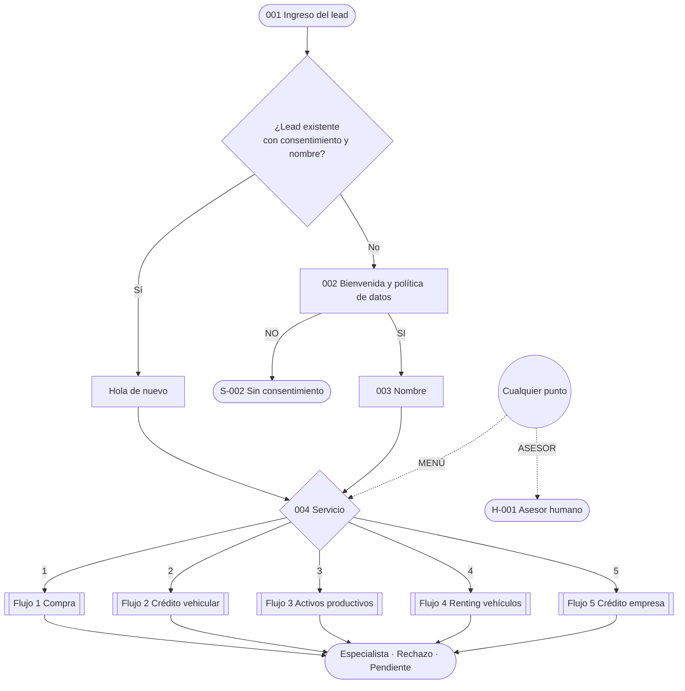

### 7.2 Flujo 1 — Compra de vehículo nuevo

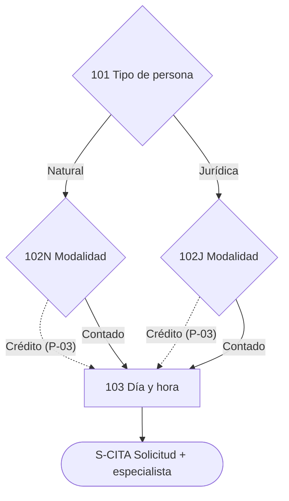

### 7.3 Flujo 2 — Gestión de crédito vehicular

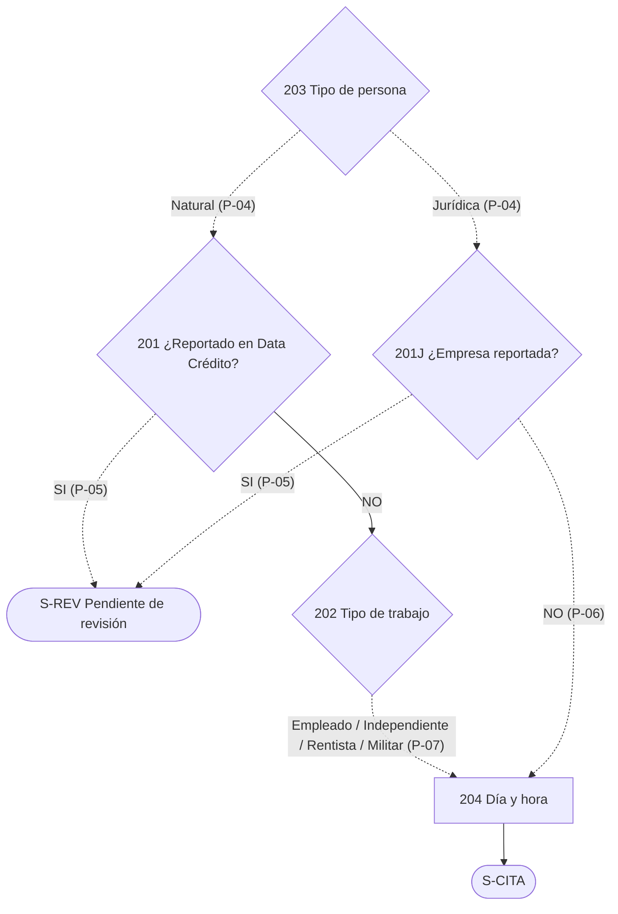

### 7.4 Flujo 3 — Renta de activos productivos

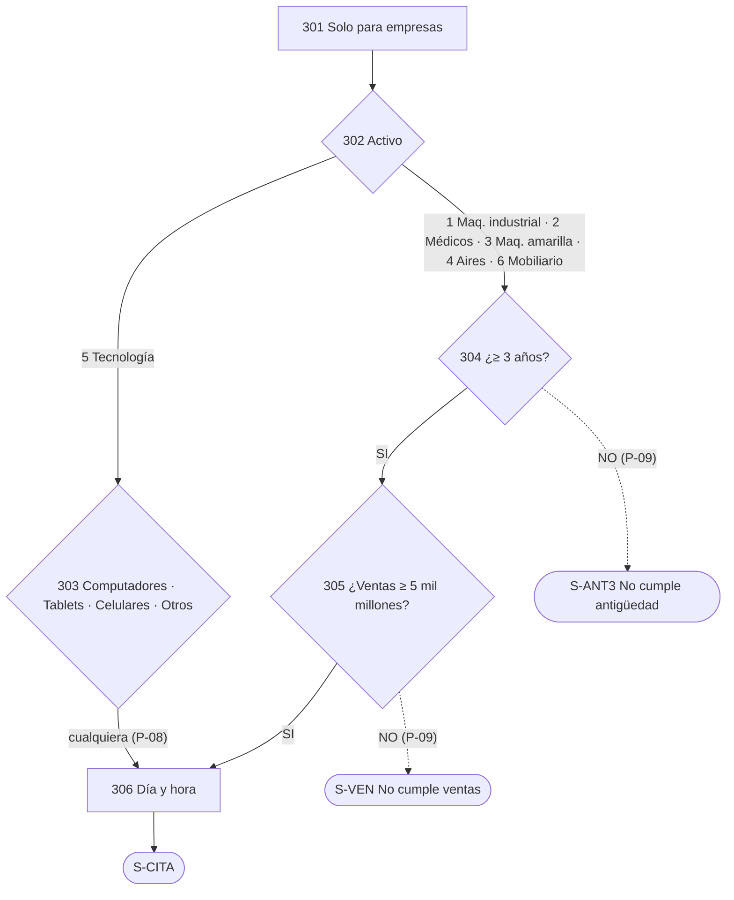

### 7.5 Flujo 4 — Renta de vehículos a largo plazo

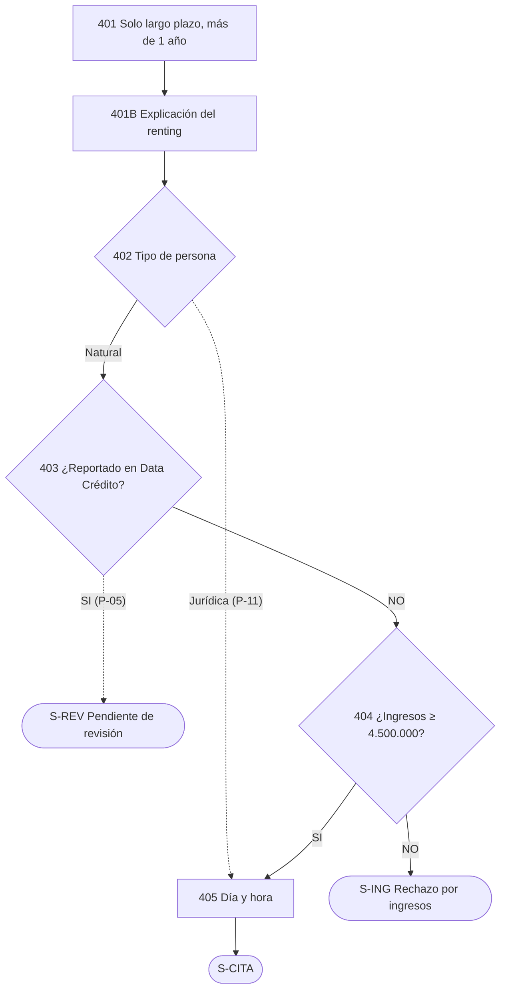

### 7.6 Flujo 5 — Crédito para tu empresa

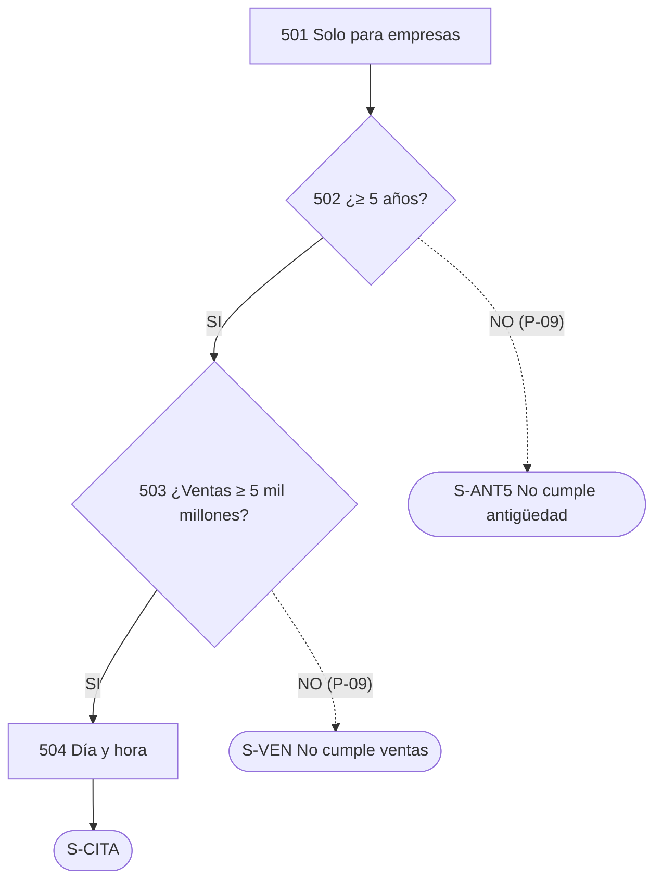

### 7.7 Decisión por mensaje entrante (motor)

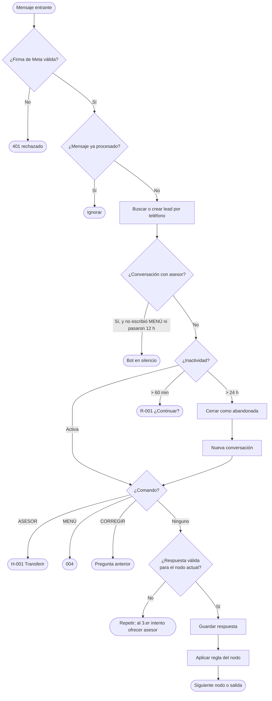

### 7.8 Registro y actualización del lead

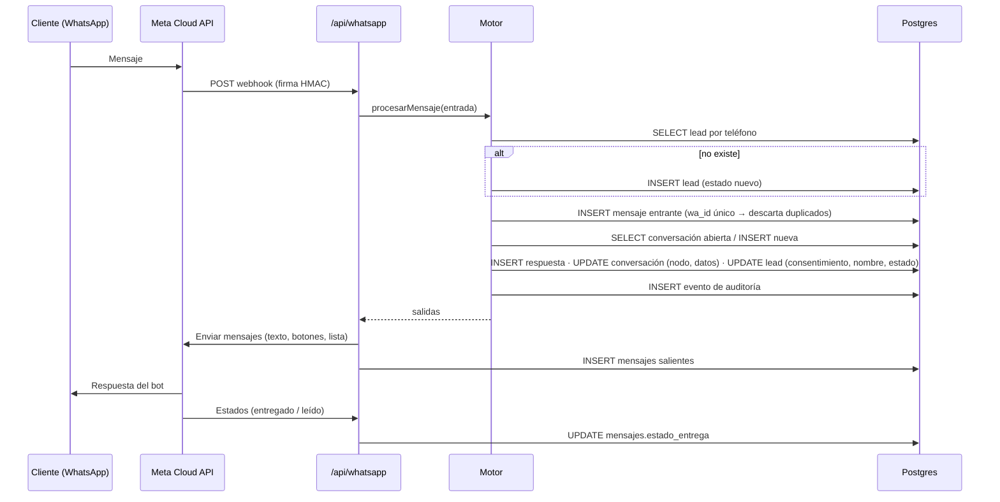

### 7.9 Asignación a especialistas

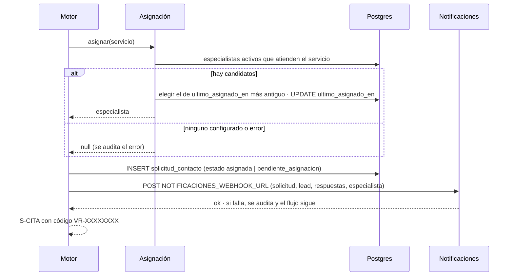

### 7.10 Excepciones y rechazos

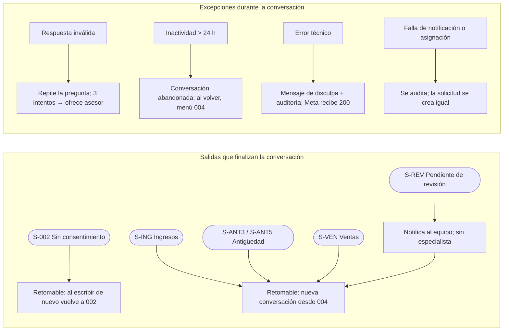

---

## 8. Matriz de reglas de negocio (trazabilidad)

| Nodo | Servicio | Pregunta original | Condición | Respuesta SI / opción A | Respuesta NO / opción B | Acción del sistema | Validación |
|---|---|---|---|---|---|---|---|
| 002 | Común | Acepta política de datos | consentimiento | → 003 | → S-002 | Guarda `consentimiento_datos` y fecha | 🟢 |
| 003 | Común | ¿Cuál es tu nombre? | 2–60 letras | → 004 | Repite | Guarda `nombre` | 🟢 |
| 004 | Común | Servicio 1–5 | opción | 1→101 · 2→203 · 3→301 · 4→401 · 5→501 | Repite | Guarda `servicio` | 🟢 |
| 101 | 1 | Tipo de persona | natural/jurídica | Natural → 102N | Jurídica → 102J | Guarda `tipo_persona` | 🟢 |
| 102N/J | 1 | Modalidad | crédito/contado | Crédito → 103 | Contado → 103 | Guarda `modalidad_compra` | 🟡 P-03 (crédito) |
| 103 | 1 | Día y hora | texto libre | → S-CITA | Repite | Crea solicitud, asigna, notifica | 🟢 |
| 203 | 2 | Tipo de persona | natural/jurídica | Natural → 201 | Jurídica → 201J | Guarda `tipo_persona` | 🟡 P-04 |
| 201 | 2 | ¿Reportado en Data Crédito? | reporte | SI → S-REV | NO → 202 | Guarda `reportado_datacredito` | 🟡 P-05 (SI) |
| 201J | 2 | ¿Empresa reportada? | reporte | SI → S-REV | NO → 204 | Guarda `empresa_reportada_datacredito` | 🟡 P-05 / P-06 |
| 202 | 2 | Tipo de trabajo | 4 opciones | Todas → 204 | — | Guarda `situacion_laboral` | 🟡 P-07 |
| 204 | 2 | Día y hora | texto libre | → S-CITA | Repite | Crea solicitud | 🟢 |
| 302 | 3 | Activo | 6 opciones | 1·2·3·4·6 → 304 | 5 → 303 | Guarda `activo` | 🟢 |
| 303 | 3 | Subtipo de tecnología | 4 opciones | Todas → 306 | — | Guarda `activo_tecnologia` | 🟢 (confirmar P-08) |
| 304 | 3 | ¿≥ 3 años? | antigüedad | SI → 305 | NO → S-ANT3 | Guarda `antiguedad_3_anios` | 🟢 / 🟡 P-09 (texto) |
| 305 | 3 | ¿Ventas ≥ 5 mil millones? | ventas | SI → 306 | NO → S-VEN | Guarda `ventas_5mm` | 🟢 / 🟡 P-09 |
| 306 | 3 | Día y hora | texto libre | → S-CITA | Repite | Crea solicitud | 🟢 |
| 402 | 4 | Tipo de persona | natural/jurídica | Natural → 403 | Jurídica → 405 | Guarda `tipo_persona` | 🟡 P-11 (jurídica) |
| 403 | 4 | ¿Reportado en Data Crédito? | reporte | SI → S-REV | NO → 404 | Guarda `reportado_datacredito` | 🟡 P-05 (SI) |
| 404 | 4 | ¿Ingresos ≥ 4.500.000? | ingresos | SI → 405 | NO → S-ING | Guarda `ingresos_4_5m` | 🟢 |
| 405 | 4 | Día y hora | texto libre | → S-CITA | Repite | Crea solicitud | 🟢 |
| 502 | 5 | ¿≥ 5 años? | antigüedad | SI → 503 | NO → S-ANT5 | Guarda `antiguedad_5_anios` | 🟢 / 🟡 P-09 |
| 503 | 5 | ¿Ventas ≥ 5 mil millones? | ventas | SI → 504 | NO → S-VEN | Guarda `ventas_5mm` | 🟢 / 🟡 P-09 |
| 504 | 5 | Día y hora | texto libre | → S-CITA | Repite | Crea solicitud | 🟢 |

Cada vez que se usa una transición 🟡, el sistema registra un evento `regla_pendiente` en la auditoría, con el código P-xx. Así se puede medir cuántos clientes pasan por cada regla provisional.

---

## 9. Modelo de datos

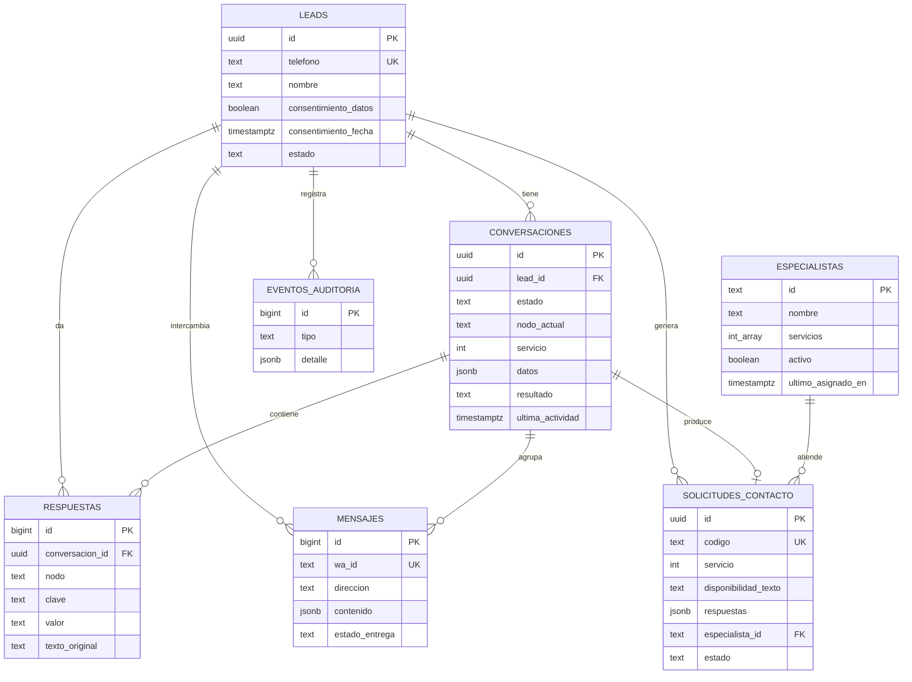

El DDL completo está en `docs/chatbot/schema.sql`.

**Decisiones de diseño:**
- **`telefono` único** identifica al lead entre conversaciones (requisitos 1 a 3).
- **`conversaciones.datos` (jsonb)** guarda la pila de navegación (para CORREGIR), las respuestas vigentes y el contexto. Permite reanudar sin consultas adicionales.
- **`respuestas`** es el historial inmutable de todo lo respondido, incluidas las respuestas que luego se corrigieron (requisito de auditoría).
- **`mensajes.wa_id` único** garantiza que un reenvío de Meta no se procese dos veces.

---

## 10. Arquitectura técnica

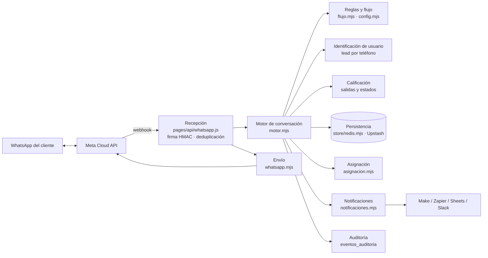

| Módulo solicitado | Implementación |
|---|---|
| Recepción WhatsApp | `src/pages/api/whatsapp.js` (verificación GET, firma `X-Hub-Signature-256`, estados de entrega) y `whatsapp.mjs#aEntrada` |
| Identificación de usuarios | `motor.mjs` § 1 (lead por teléfono, creación idempotente) |
| Motor de conversación | `motor.mjs` (máquina de estados: comandos, reanudación, validación, transición) |
| Reglas de negocio | `flujo.mjs` (transiciones declarativas con estado original/pendiente) y `config.mjs` (umbrales) |
| Calificación de leads | Nodos de salida (`S-*`) → `leads.estado` y `conversaciones.resultado` |
| Persistencia | Interfaz `store` con implementaciones Upstash Redis (producción), memoria (pruebas) y Postgres (opcional) |
| Asignación de asesores | `asignacion.mjs` (round-robin por servicio; tabla o `ESPECIALISTAS_JSON`) |
| Notificaciones | `notificaciones.mjs` (webhook genérico configurable) |
| Auditoría | `eventos_auditoria` y `mensajes` |

**Por qué estas tecnologías:**
- **Next.js API Routes en Vercel:** el sitio ya corre ahí, así que no hay que operar otro servidor. Cada mensaje del webhook es una solicitud corta, ideal para funciones serverless.
- **Upstash Redis (elegido para producción):** plan gratuito, sin dependencias (API REST con `fetch`), se conecta desde Vercel con un clic y conserva el estado entre ejecuciones serverless. Los reportes comerciales se obtienen en Google Sheets mediante el webhook de notificaciones (también gratis).
- **PostgreSQL (Neon), alternativa preparada:** los requisitos son relacionales (lead → conversaciones → respuestas → solicitudes), con unicidad (teléfono, `wa_id`) y reportes comerciales en SQL. Neon funciona sobre HTTP y es nativo del Marketplace de Vercel, con conexión en un clic y plan gratuito. Una base clave-valor (Redis) serviría para el estado, pero complicaría los reportes.
- **JavaScript (ESM) sin framework de bots:** el flujo es determinista (reglas, no IA), por lo que una máquina de estados propia y declarativa es más simple, más auditable y más fácil de cambiar que Botpress o Dialogflow, y no tiene costo de licencia.

---

## 11. Estados de los leads

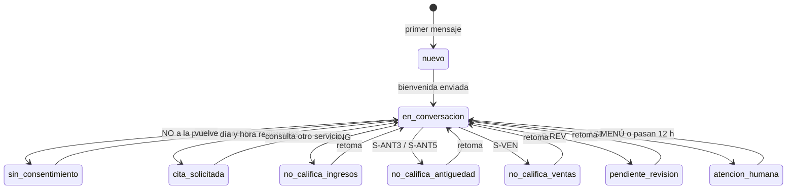

**Estados de la conversación:** `activa` → `finalizada` (con `resultado` = código de salida) · `atencion_humana` · `abandonada` (más de 24 h sin respuesta).

**Estados de la solicitud de contacto:** `asignada` · `pendiente_asignacion` (sin especialista disponible). El equipo comercial la mueve a `contactado` y luego a `cerrada`.

| Salida | ¿Finaliza? | ¿Retomable? |
|---|---|---|
| S-002 Sin consentimiento | Sí | Sí, en el siguiente mensaje se pide de nuevo la autorización |
| S-ING / S-ANT / S-VEN | Sí | Sí, en una nueva conversación (desde el menú 004) |
| S-REV Pendiente | Sí para el bot; el caso sigue abierto para el equipo | Sí |
| S-CITA | Sí (solicitud creada) | Puede consultar otro servicio |

---

## 12. Casos de prueba

Automatizados en `tests/chatbot.test.mjs` (59 casos, todos en verde: 52 del motor y 7 del almacenamiento Upstash contra un simulador de su API). Se ejecutan con `npm run test:chatbot`.

| Caso pedido | Cobertura |
|---|---|
| Usuario nuevo | Bienvenida 002, creación del lead, estado `en_conversacion` |
| Usuario existente | Saluda con el nombre y no repite consentimiento ni nombre |
| Persona natural / jurídica | Flujos 1, 2 y 4 con ambas ramas; verifica la pregunta correcta ("usted" o "su empresa") |
| Respuesta afirmativa / negativa | Todas las preguntas SI/NO de los 5 flujos, con su destino |
| Datos incompletos | Nombre inválido, disponibilidad vacía y mensajes sin texto (foto/audio) |
| Respuesta inválida | Repite la pregunta; al 3.er intento ofrece asesor |
| **Ruta incorrecta** | Un botón de otra pregunta se rechaza; todas las transiciones apuntan a nodos existentes; ninguna salida de rechazo o pendiente crea solicitud |
| Abandono | Más de 24 h: la conversación queda `abandonada` y la nueva no repite datos |
| Reanudación | Más de 60 min: "¿Continuar?", con las opciones continuar y empezar de nuevo |
| Solicitud de asesor | ASESOR transfiere; el bot calla hasta MENÚ; funciona incluso antes del consentimiento |
| Error de integración | Si falla la asignación, la solicitud se crea como `pendiente_asignacion` y se audita; un mensaje duplicado de Meta se ignora |
| Asignación | Round-robin entre los especialistas del servicio; no asigna a quien no lo atiende |
| Límites de WhatsApp | Todos los botones ≤ 20 caracteres, filas ≤ 24, cuerpo ≤ 1024 |

Además se verificó la integración de punta a punta: un webhook firmado (HMAC), la conversación completa del flujo 4 y la revisión de los mensajes reales generados para WhatsApp.

---

## 13. Preguntas pendientes de negocio

| Código | Pregunta | Implementación provisional |
|---|---|---|
| **P-01** | ¿Cuál es la URL oficial de la política de tratamiento de datos? | `/terminos` del sitio (variable `POLITICA_DATOS_URL`) |
| **P-02** | ¿El nombre comercial es "VenteRental" o "VentRentAll"? | "VenteRental" (constante `MARCA`) |
| **P-03** | Compra de vehículo: ¿qué ramificaciones adicionales hay por tipo de persona? ¿"Con crédito" debe pasar por las validaciones del flujo 2? | Ambas modalidades van al especialista |
| **P-04** | Crédito vehicular: ¿se pregunta el tipo de persona antes de Data Crédito? | Sí (203 → 201/201J) |
| **P-05** | Si el cliente (o su empresa) **está reportado** en Data Crédito, ¿qué se hace: rechazo, especialista u otra ruta? | Salida S-REV: queda pendiente de revisión, sin especialista y se notifica al equipo |
| **P-06** | Crédito vehicular, persona jurídica no reportada: ¿hay más preguntas (antigüedad, ventas)? | Va al especialista |
| **P-07** | Crédito vehicular: ¿algún tipo de trabajo tiene condiciones distintas o preguntas extra (ingresos, antigüedad laboral)? | Los 4 van al especialista |
| **P-08** | Activos, Tecnología: ¿realmente se salta la validación de antigüedad y ventas? | Sí, como indica el texto |
| **P-09** | Textos de salida por antigüedad y por ventas (no hay texto original). ¿Se ofrece otro servicio? | Textos propuestos S-ANT3, S-ANT5 y S-VEN |
| **P-10** | Plazo del renting: ¿"más de 1 año" o "más de 2 años" (como dice el sitio web)? | "Más de 1 año" (original) |
| **P-11** | Renting de vehículos, persona jurídica: ¿qué preguntas y condiciones aplican? | Va al especialista |
| **P-12** | ¿Se puede cambiar "Sr./Señor" por un trato neutral ("Sr(a).")? | Se conserva el original |
| **P-13** | "5 mil millones anual": ¿pesos colombianos y ventas brutas? | Texto exacto |
| **P-14** | ¿Horario de atención de especialistas? ¿Qué decir fuera de horario? ¿En cuánto tiempo se contacta al cliente? | Sin restricción horaria |
| **P-15** | ¿El día y la hora deben validarse contra una agenda real o un horario hábil? | Se guarda como texto libre |
| **P-16** | Lista de especialistas, servicios que atiende cada uno y canal de aviso (WhatsApp, correo, CRM). | Tabla `especialistas` o variable `ESPECIALISTAS_JSON`; aviso por webhook |
| **P-17** | Retención de datos y atención de solicitudes de supresión (Ley 1581 de 2012). | Sin borrado automático |

---

## 14. Recomendaciones de implementación

**Para salir a producción, en orden:**
1. **Base de datos (gratis):** Vercel → Storage → **Upstash for Redis** (plan Free). Crea `KV_REST_API_URL` y `KV_REST_API_TOKEN` y el bot las detecta solo. **Sin este paso, en Vercel las conversaciones se pierden entre mensajes.**
2. **Meta:** crear la app, el número y el token, y configurar el webhook (`docs/whatsapp-bot.md`).
3. **Especialistas y avisos (gratis):** variable `ESPECIALISTAS_JSON` y hoja de Google Sheets con `docs/chatbot/google-sheets-apps-script.gs` como `NOTIFICACIONES_WEBHOOK_URL`.
4. **Responder P-01 a P-17.** Cada respuesta es un cambio puntual en `flujo.mjs` (destino de una transición o texto de un nodo), y las pruebas confirman que no se rompió ninguna ruta.

**Mejoras recomendadas (no incluidas):**
- **Panel comercial:** una vista protegida en el sitio para ver solicitudes, cambiar su estado y leer el historial.
- **Plantillas de Meta** para avisar al especialista por WhatsApp y para recordatorios al cliente fuera de la ventana de 24 h. Requieren aprobación de Meta y tienen costo por mensaje.
- **Bloqueo por lead** (por ejemplo, `SELECT … FOR UPDATE`) si se observan mensajes simultáneos del mismo cliente que se pisen.
- **Métricas:** embudo por servicio (inicio → precalificación → solicitud), tasa de abandono por nodo y uso de las reglas pendientes (eventos `regla_pendiente`).
- **Accesibilidad de respuesta:** aceptar audios mediante transcripción automática.
